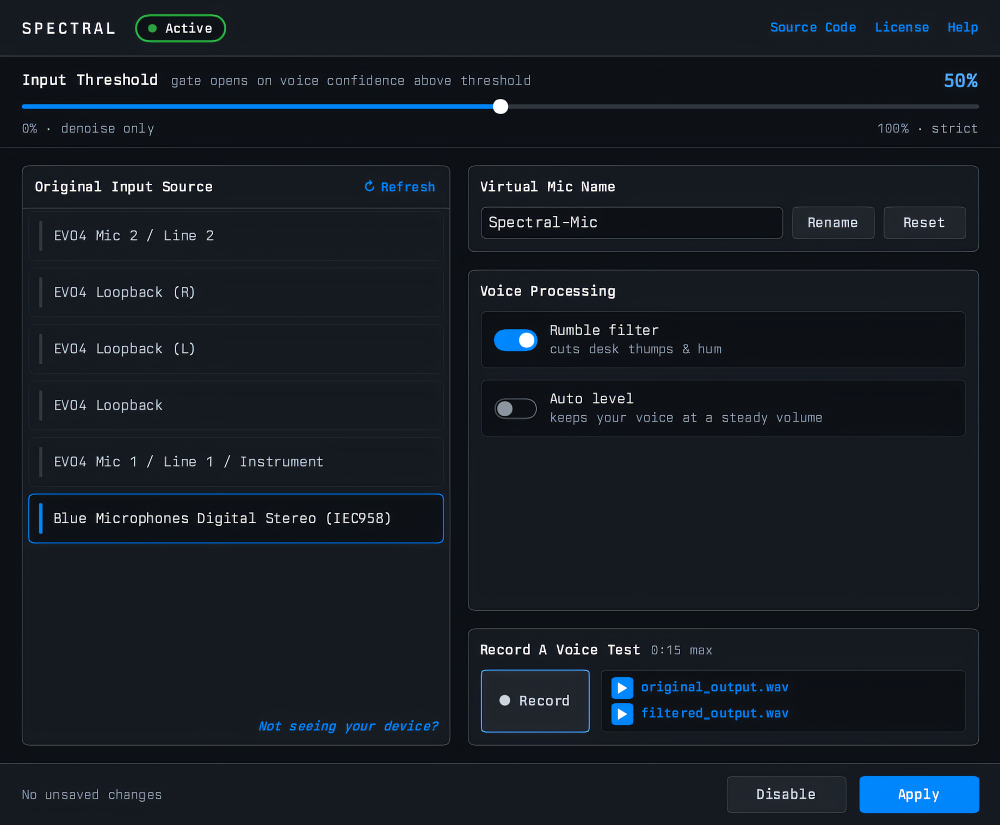

#  Spectral

**Real-time microphone noise suppression for Linux.**

Spectral runs a microphone you choose through the RNNoise neural network and exposes the result as a native PipeWire virtual mic. Any application — your browser, a chat client, OBS — can select it like any other input. Keyboard clatter, fans, and room tone go; your voice stays.

[RNNoise](https://arxiv.org/pdf/1709.08243) is a hybrid DSP and neural-network noise suppressor by Jean-Marc Valin, developed at Mozilla and published through Xiph.Org.

## Features

- Real-time RNNoise denoising, with a voice-activity gate you can dial from off (denoise only) to strict
- A native PipeWire virtual mic that any application can select, and that becomes your system default input when you enable it
- A built-in voice test — record yourself and compare original against filtered
- Two optional voice-processing switches, both off by default: a rumble filter and automatic volume leveling
- Settings persist across restarts, and your device is remembered by name, so it survives reboots and PipeWire restarts
- A headless CLI, so usage does not require the GUI

## Requirements

- Linux with **PipeWire** and its session manager, **WirePlumber**
- Wayland or X11
- x86_64 or aarch64

Confirmed working on x86_64 and on aarch64.

## Installation

Spectral is in nixpkgs as `spectral-mic`; the other paths build from packaging kept in this repository.

| Path                        | What you get                                                   |
| --------------------------- | -------------------------------------------------------------- |
| nixpkgs `spectral-mic`      | The packaged release, installed as `spectral`                  |
| Nix flake (this repository) | The latest commit, plus the NixOS module nixpkgs does not ship |
| Flatpak                     | A sandboxed build from the included manifest                   |

Manual builds may work but are unsupported. Which of these are published yet, and the commands, build steps, and caveats for each, are in [docs/INSTALLATION.md](docs/INSTALLATION.md).

## Usage

1. Launch the GUI: `spectral` (the daemon starts automatically)
2. Select your input device from the list
3. Adjust the threshold: higher values gate more strictly on voice activity
4. Optionally flip any of the Voice Processing switches
5. Click "Enable" — the virtual mic is created and becomes the system default input
6. Applications that pin a specific device can select the virtual mic by name (default "Spectral-Mic"); "Rename"/"Reset" stage a new name, applied on the next Enable/Apply

## Screenshot

> Everything the GUI does is also available from the terminal. The full reference is in [docs/CLI.md](docs/CLI.md).

  

## How it works

A background daemon owns all the audio work: it captures your chosen device, downmixes to mono, and runs each 10 ms frame through its DSP chain — RNNoise denoising, the voice gate, and the two optional stages when you switch them on — before feeding a PipeWire virtual source node, the microphone other applications see. The GUI and the CLI are thin clients over a Unix socket, holding no audio state of their own, and because the daemon owns every PipeWire object it creates, the virtual mic disappears cleanly when the daemon stops. For the chain and its order, the module map, the real-time constraints, and the IPC protocol, see [docs/ARCHITECTURE.md](docs/ARCHITECTURE.md).

## Help

Devices that don't show up, applications that don't offer the virtual mic, multi-channel interfaces, and the current known limitations are covered in [docs/TROUBLESHOOTING.md](docs/TROUBLESHOOTING.md).

## Alternatives

If you're coming from **NoiseTorch**: it solved this problem for PulseAudio and is no longer maintained. Spectral targets PipeWire natively rather than loading PulseAudio modules, and adds a daemon with both a GUI and a CLI. Same core idea, same RNNoise denoiser.

**[EasyEffects](https://github.com/wwmm/easyeffects)** is a broader audio-effects suite that can do far more than noise suppression, including on output — which Spectral deliberately does not do. If you already run EasyEffects and are happy with it, you don't need this.

## Privacy

All processing happens on your machine. Spectral makes no network connections and has no telemetry. The only audio it writes to disk comes from voice-test recordings you start yourself, under `~/.local/state/spectral/recordings`.

## Contributing

Bug reports and patches are welcome. Development happens on [Codeberg](https://codeberg.org/mmc/spectral); see [CONTRIBUTING.md](CONTRIBUTING.md) for the build, the required checks, and the commit conventions, and [docs/ARCHITECTURE.md](docs/ARCHITECTURE.md) for a map of the codebase. What makes a bug report useful is listed under [Reporting a bug](docs/TROUBLESHOOTING.md#reporting-a-bug).

## License

Spectral is licensed under the GPL-3.0-only (see [LICENSE](LICENSE)). Statically linked third-party components are attributed in [THIRD-PARTY.md](THIRD-PARTY.md).
