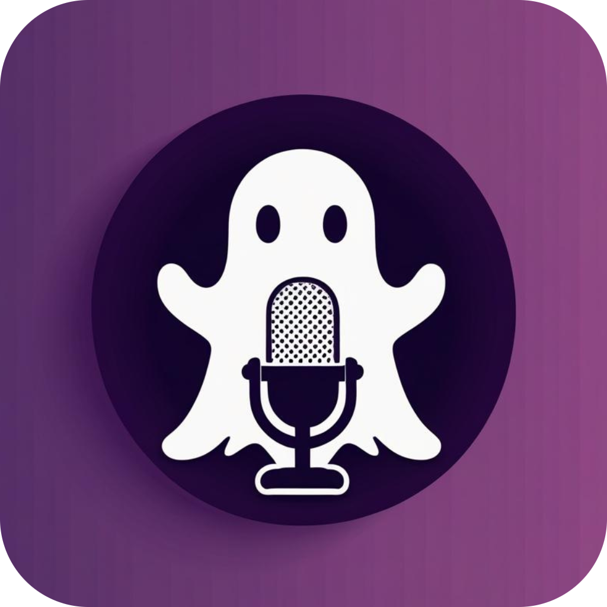

<div align="center">
  
  <p>
    <a href="https://codeberg.org/mmc/spectral/actions?workflow=ci.yml">
      
    </a>
    <a href="LICENSE">
      
    </a>
  </p>
</div>

# Spectral

A real-time audio noise suppression application powered by [RNNoise](https://arxiv.org/pdf/1709.08243), a hybrid DSP and neural-network–based noise suppression system originally developed by Xiph.org.

<details>
<summary>Table of Contents</summary>

- [Features](#features)
- [Architecture](#architecture)
- [Installation](#installation)
- [Usage](#usage)
  - [Headless CLI](#headless-cli)
- [Troubleshooting](#troubleshooting)
- [Known limitations](#known-limitations)
- [Non-goals](#non-goals)
- [License](#license)

</details>

## Features

- Real-time RNNoise denoising with an adjustable voice-activity gate
- Native PipeWire virtual microphone, owned by the daemon — it disappears the instant the daemon exits, so stale devices cannot accumulate
- Automatically set as the system default input on Enable
- Built-in voice test to compare original and filtered audio
- Persistent settings across sessions

## Architecture

- **spectral** - GUI application for controlling noise suppression
- **spectral-daemon** - Background service that manages audio processing
- IPC communication via Unix domain sockets

## Installation

> Nix and the AUR are the supported installation methods.
> Spectral requires a running PipeWire session with its session manager
> (WirePlumber). Manual builds may work but are unsupported.

<details>
<summary><strong>NixOS / Nix</strong></summary>

**Option 1: Direct installation (try it out)**

```bash
# Run directly without installing
nix run git+https://codeberg.org/mmc/spectral

# Or build and install to your profile
nix profile add git+https://codeberg.org/mmc/spectral
```

**Option 2: NixOS declarative installation**

Add to your `flake.nix` inputs:

```nix
{
  inputs = {
    spectral.url = "git+https://codeberg.org/mmc/spectral";
  };
}
```

Then in your NixOS configuration:

```nix
{ inputs, ... }:
{
  imports = [ inputs.spectral.nixosModules.default ];

  # Apply the overlay to make pkgs.spectral available
  nixpkgs.overlays = [ inputs.spectral.overlays.default ];

  # Enable Spectral
  programs.spectral.enable = true;
}
```

**Option 3: Using the overlay only**

If you prefer manual control over installation:

```nix
{
  nixpkgs.overlays = [ inputs.spectral.overlays.default ];

  # Then use pkgs.spectral anywhere
  environment.systemPackages = [ pkgs.spectral ];
}
```

</details>

<details>
<summary><strong>Arch Linux (AUR)</strong></summary>

```bash
paru -S spectral-mic   # or: yay -S spectral-mic
```

The package is named `spectral-mic` and conflicts with the unrelated AUR
package `spectral`, which ships the same binary name. Publication to the AUR
begins with the first announced release; until then the PKGBUILD lives in
[packaging/aur](packaging/aur).

</details>

## Usage

1. Launch the GUI: `spectral` (the daemon starts automatically)
2. Select your input device from the list
3. Adjust the threshold: 0% is denoise-only, higher values gate more strictly on voice activity
4. Click "Enable" — the virtual microphone is created and becomes the system default input
5. Applications that pin a specific device can select the virtual mic by name (default "Spectral-Mic"); "Rename"/"Reset" stage a new name, applied on the next Enable/Apply

### Headless CLI

The `spectral` binary doubles as a command-line client:

```bash
spectral devices              # list input devices and their current ids
spectral enable --device 62   # create the virtual mic (spawns the daemon if needed)
spectral enable               # re-enable with the remembered settings
spectral status               # show state, device, mic name, threshold
spectral disable              # tear the virtual mic down
spectral shutdown             # stop the daemon
```

`enable` accepts `--device <id>`, `--threshold <0-100>`, and `--mic-name <name>`;
omitted flags keep the current settings. Device ids are scoped to the running
PipeWire instance — the daemon remembers the selected device by node name, so a
flagless `spectral enable` works across reboots and PipeWire restarts.

Exit codes: 0 on success (including a no-op `disable`/`shutdown`), 1 on runtime
failures, 2 on usage errors.

## Troubleshooting

- **Your microphone isn't listed:** click "Refresh", or see the in-app "Not seeing your device?" guide.
- **After a PipeWire restart** (e.g. `systemctl --user restart pipewire`): the device list points at devices that no longer exist — click "Refresh" and re-select before enabling.
- **Something failed:** errors appear under the status bar; the daemon also logs to `$XDG_RUNTIME_DIR/spectral-daemon.log`.
- **Voice-test recordings** are saved under `~/.local/state/spectral/recordings`.

## Known limitations

- The window's minimum size is 920×800, which does not fit 768p displays. A responsive-layout fix is planned.
- Inputs with more than two channels and Bluetooth microphones are untested.
- Voice-test recordings are not restored in the UI after relaunching the GUI.

## Non-goals

- Denoising incoming audio (a "headphones sink") — [EasyEffects](https://github.com/wwmm/easyeffects) covers this well.
- Systems without PipeWire (pure PulseAudio, ALSA, or JACK).
- Self-updating — package managers own updates.

## License

Spectral is licensed under the GPL-3.0-only (see [LICENSE](LICENSE)).
Statically linked third-party components are attributed in
[THIRD-PARTY.md](THIRD-PARTY.md).
