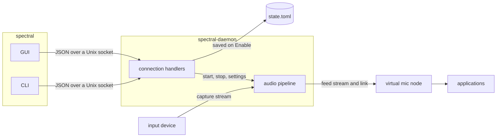
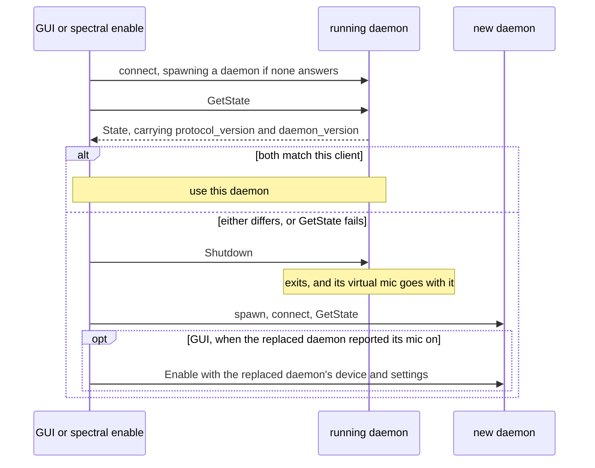
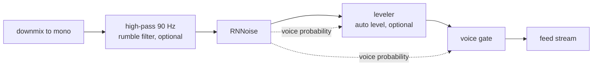
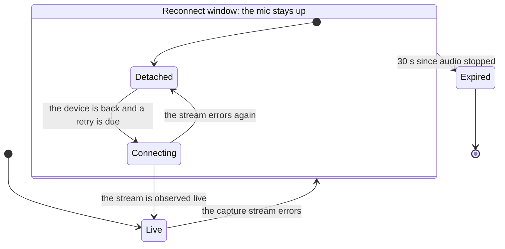

# Architecture

How Spectral is put together, for anyone about to change it. The overview and the opening paragraph of each section give the shape; the rest is detail for whoever touches that part. Building, testing and submitting patches are in [CONTRIBUTING.md](CONTRIBUTING.md).

## Overview

Spectral is two processes. `spectral-daemon` owns everything that touches audio: it captures the chosen input device, runs every 10 ms of it through a denoising chain, and feeds the result into a virtual mic in the PipeWire graph, which any application can select. `spectral` is a thin client, the GUI or the CLI, that tells the daemon what to do over a Unix socket and shows what it reports. It does no audio work.

One crate builds both binaries and the library they share:

| Component | Entry point | Role |
| --- | --- | --- |
| `spectral` | `src/main.rs` | The Slint GUI, and the CLI (`src/cli.rs`) when given a subcommand. |
| `spectral-daemon` | `src/bin/spectral-daemon.rs` | Owns the audio state and the virtual mic, persists settings, serves clients. |
| `spectral_lib` | `src/lib.rs` | Shared code: the state types, IPC, and the platform layer under `src/platform/`. |

## The daemon and its clients

The daemon is the only owner of audio state, and it outlives the clients that start it. Clients reach it on `$XDG_RUNTIME_DIR/spectral-daemon.sock` with a short-lived connection for each exchange, and the daemon serves each connection on a handler thread of its own until the client closes it. The GUI at launch and `spectral enable` spawn the daemon if none answers; a lock on `$XDG_RUNTIME_DIR/spectral-daemon.pid` decides which one wins when two try at once.

`start_daemon` (`src/daemon_launch.rs`) runs the `spectral-daemon` beside the client's own executable, in a process group of its own, so Ctrl-C in the launching terminal, or closing it, cannot take the mic down with the client.

The runtime dir is required, with no second location to fall back to. An unset, empty or relative `XDG_RUNTIME_DIR` is rejected as one condition: the XDG spec treats empty as absent, and a relative value would resolve the socket into the process's working directory, outside the mode-0700 runtime dir that is what actually keeps other local users out. The commands that only connect report the daemon as not running ([CLI.md](CLI.md)); `enable` names the real cause, because the rejection comes from its spawn attempt, before the daemon process is created rather than after a connect timeout.

The daemon writes only to its inherited stdout and stderr and never creates a log. A client that spawns it redirects those to `spectral-daemon.log` in the same runtime dir, resolved through the same check, so the log cannot land somewhere the socket could not, and the daemon that wins the pid lock empties that file before writing (`start_log_afresh`). A daemon started any other way, from a shell or a service manager, logs wherever its parent's stdio points, though it still empties a log an earlier spawned daemon left behind.

Because the daemon owns every PipeWire object it creates, the virtual mic disappears when the daemon exits. There is nothing to reap and no state left in the audio graph.

### Launch and replacement

Before using the daemon it reached, the GUI at launch and `spectral enable` check that it is their own version (`connect_and_fetch_state`, `src/daemon_launch.rs`):

`PROTOCOL_VERSION` guards the wire format: bump it when a change is incompatible. `daemon_version`, the daemon's crate version, catches everything else, so an upgraded client is never left talking to a daemon from a previous install, and a rollback gets its own; older or newer, either mismatch replaces it. A version change alone needs no protocol bump: `daemon_version` is optional, and a daemon without it counts as another version. A daemon that still mismatches after one replacement is used anyway, with a warning, since a second restart would only repeat the mismatch.

The GUI's restore (`restore`) re-sends the replaced daemon's device and settings. `spectral enable` sends its own `Enable` instead, and restores only when the new daemon rejects it. Nothing else replaces a daemon: `spectral status` warns about another version and fails on another protocol, `disable` and `shutdown` do not check, and the GUI's poll does not either, so a window left open across an upgrade never restarts the newer daemon.

### The GUI is a view

The GUI holds no authoritative state. A Slint timer in `ui/app-window.slint` polls the daemon every second, every 250 ms during voice-test playback, and the GUI reconciles status and errors from each snapshot.

Because the GUI holds no connection open between exchanges, the daemon has no disconnect to act on: a closed window looks exactly like an idle one. So the GUI sends the voice-test stops it still owes, `StopRecording`, `StopOriginal` and `StopFiltered`, after its event loop exits (`stop_playback_and_recording_on_exit`, `src/main.rs`). This is best effort; a killed process sends nothing, which is what the recorder's own cap (`MAX_RECORDING_SAMPLES`, 60 s) backstops. The virtual mic deliberately survives the window and is never torn down here.

## The audio path

The pipeline is a PipeWire client inside the daemon. A capture stream reads the selected device, the processing chain runs inside that stream's real-time callback, and a second stream, the feed, carries the result over an explicitly created link into a daemon-owned `Audio/Source/Virtual` node: the microphone applications see. `VirtualMic` (`src/platform/linux/audio_processor.rs`) owns its lifecycle, and `NativeAudioPipeline` (`src/platform/linux/pipewire.rs`) runs it on a dedicated thread with its own PipeWire main loop. Enabling also makes the virtual mic the system's default input.

Capture negotiates the device's native channel count, clamped to `MAX_INPUT_CHANNELS` (8), so wider devices are captured as their first eight. The granted count arrives only with the first Format param and is verified there: a count outside `1..=8`, or one that changes once locked, halts the pipeline rather than deinterleaving with a wrong stride. The input buffer is reserved for the ceiling up front, since the granted count is not known when the buffers are allocated.

Deliveries arrive in whatever size the graph's quantum sets, and the capture callback buffers them into 480-sample frames, 10 ms at 48 kHz, the size RNNoise requires. Each frame then runs this chain:

1. **Downmix to mono** and scale into the i16-range floats RNNoise expects (`RNNOISE_SCALE_FACTOR`, `pipewire.rs`). Only the front pair is averaged when the device offers more than two channels, since the rest typically carry loopback or monitor returns.
2. **High-pass** at 90 Hz: the rumble filter, off by default. A second-order Butterworth biquad, applied *before* the denoiser so RNNoise and its voice detection analyze a rumble-free signal (`stages/highpass.rs`).
3. **RNNoise denoise**, which also returns the frame's voice-activity probability, 0.0 to 1.0. That probability drives both stages below.
4. **Leveler**: auto level, off by default. A slow RMS-tracking gain rider toward −18 dBFS with a peak limiter, frozen on non-voice frames so noise floors are never pumped up (`stages/leveler.rs`).
5. **Voice gate**, always in the chain. Turns the voice probability into a click-free gain using 20 ms of lookahead, hysteresis, a 200 ms hold, and a −20 dB floor rather than a hard mute (`stages/gate.rs`).

`AudioProcessor::process_frame` (`audio_processor.rs`) composes stages 2 to 5 in that order and is the authoritative reference for them; the downmix runs before it, in the capture callback (`mix_to_mono`, `pipewire.rs`). It reads the user's settings from atomics on `AppState` every frame, so toggling a stage applies live without ever locking the audio path.

Two latency contributions are fixed and independent of settings: RNNoise's 10 ms algorithmic delay, and the gate's 20 ms lookahead. The gate's delay is constant even when the gate is bypassed, so latency never shifts as the user changes the threshold. Everything else depends on the PipeWire graph quantum, which any client on the system can change.

The threshold maps to a voice-confidence cutoff through `vad_cutoff`: 0 disables the gate entirely (denoise only), and 1 to 100 map linearly onto a cutoff of up to 0.95.

## Losing the capture device

Unplugging the input device does not end the pipeline. The virtual mic node and its link stay up and go quiet, so an application holding the mic keeps its device, while the pipeline spends up to `RECONNECT_TIMEOUT` (30 s) getting the capture stream back. `ReattachState` in `pipewire.rs` is the whole policy:

`ReattachState::step` returns `Retry` on the edge into Connecting, at most every 500 ms (`REATTACH_RETRY_INTERVAL`), `GiveUp` on the edge into Expired, where the pipeline records a failure and exits, `Waiting` otherwise while detached, and `Attached` whenever no window is open. A capture error before `Enable` has returned is not a detach but a failure: nothing holds the mic yet, so a window would protect no audio.

One unplug is reported twice in the same loop iteration: as `StreamState::Error` on the capture stream, and as a core `-ENOENT` on its proxy. `core_error_is_lost_target` is what separates that from a failure of the connection itself, which must stay fatal.

The rules in `step` are load-bearing, and each exists because the obvious version misbehaves:

- The deadline runs from when audio stopped, not from the last detach, so a device flapping just under the timeout still expires.
- No retry is issued while an attempt is in flight. A Bluetooth headset acquires its SCO transport *because* a capture stream asked for it, which routinely takes seconds; retrying on the interval would restart that from zero forever. The deadline is checked ahead of this, so a stream stuck connecting still expires on time.
- Only a stream observed live closes the window. Counting a successful connect would hand a device that errors immediately afterward an unlimited number of full windows.

A re-attach drops the format lock, so a replugged device is free to negotiate a different channel count, and calls `AudioProcessor::reset_for_reattach` to clear the stage state and flush the denoiser's overlap-add tail (`DENOISER_FLUSH_FRAMES`) rather than mixing it into the new stream.

While the window is open, the pipeline's `detached` atomic surfaces as `DaemonState::capture_detached`, which is what the GUI's "Reconnecting" status and `spectral status`'s `(reconnecting)` report. Anything that changes the capture stream's lifecycle has to keep this path intact: it is the difference between a call carrying on and an application losing its microphone mid-sentence.

## Threads

Every thread, and what it may do. The constraints column is where most subtle bugs in this codebase have come from.

| Process | Thread | What runs there | Constraints |
| --- | --- | --- | --- |
| `spectral` | main | The Slint event loop, its poll timer, and every IPC round trip the GUI makes | |
| `spectral` | one reaper per spawned child | Waits on the spawned daemon or `xdg-open`, so neither lingers as a zombie | |
| `spectral-daemon` | main | The accept loop | |
| `spectral-daemon` | signal | Waits for SIGTERM or SIGINT, then clears `running` and wakes the accept loop | |
| `spectral-daemon` | one handler per connection (`handle_client`) | The connection's commands, one at a time until it closes: starts and stops subsystems, persists the settings an `Enable` carries, replies | Takes locks in the documented order |
| `spectral-daemon` | pipeline (`run_pipeline`) | The pipeline's PipeWire main loop: negotiation, the link, the reconnect window | The only thread that records a pipeline failure |
| `spectral-daemon` | PipeWire data threads, one per context with a real-time stream | The pipeline's capture and feed `process` callbacks and the chain inside them; the player's playback callback | No locks, no allocation, no I/O |
| `spectral-daemon` | recorder (`run_recorder`) | The voice-test recording: the device and the virtual mic, side by side, to WAV | Not real-time: its callback writes files |
| `spectral-daemon` | player (`run_player`) | The voice-test player's PipeWire main loop: setup, and polling for the end of the clip, whose playback callback runs on a data thread | |

**The real-time path takes no locks and makes no allocations.** Stages allocate their buffers in `new` and reuse them, and a buffer large enough to be mmap-backed is also written to its full capacity there, so the real-time thread never takes a first-touch page fault on memory that was merely reserved. Settings reach it through atomics. Any change to `process_frame` or a stage's `process` must preserve this.

Both pipeline callbacks share one `Rc<RefCell<PipelineData>>`, the capture side appending to its output buffer and the feed side draining it. That is sound only because a PipeWire client context runs a single data loop by default, which puts both callbacks on the same thread; anything that would let the two streams run concurrently has to replace it with a single-producer, single-consumer ring first.

Handle structs that own a thread are named `Native*` and follow one lifecycle, with `NativeRecorder` as the reference: a `running: Arc<AtomicBool>` flag, a `failure: Arc<Mutex<Option<String>>>` slot, and an `Option<JoinHandle<()>>`. `start()` blocks on an mpsc ready-handshake so callers know the thread is live; `stop()` clears the flag and joins; `Drop` calls `stop()`. Thread bodies are named `run_*`.

The pipeline thread blocks in its PipeWire loop rather than polling it. `stop()` also sends on a `pipewire::channel` attached to the loop, so the join returns promptly, and the reconnect window's state names how long the loop may sleep before its next retry or deadline, capped at one second so that a path with no wake to send still notices the flag. Failures are only ever recorded on the pipeline thread itself, from the loop body or a loop callback, never from the data thread or anywhere else; that is what lets the loop block without missing one.

Off the audio path, the daemon guards optional subsystems with `Arc<Mutex<Option<T>>>`, and inside the single-threaded PipeWire callbacks, shared state is `Rc<RefCell<…>>`. All lock acquisition goes through `lock_or_recover` (`src/state.rs`), which recovers from poisoning rather than panicking: a long-lived daemon prefers stale data to a crash, especially where a panic would cross the PipeWire FFI boundary.

**Locks are acquired in the documented order.** It is written out in the `LOCK ORDERING CONVENTION` comment at the top of `src/bin/spectral-daemon.rs`; read it before adding a lock acquisition, and keep guard scopes minimal.

## IPC protocol

JSON request and response, one message per line, defined in `src/platform/linux/ipc.rs`. Every command gets back a `DaemonResponse`: `Ok`, `State(DaemonState)`, or `Error(String)`, so errors cross the socket stringified.

| `DaemonCommand` | What it does |
| --- | --- |
| `Enable` | Turns the virtual mic on. Every setting is an `Option`; `None` keeps what the daemon already has. |
| `Disable` | Tears the virtual mic down. |
| `GetState` | Returns the `DaemonState` snapshot that clients render. |
| `Shutdown` | Stops the daemon. |
| `StartRecording`, `StopRecording` | The voice test's recording. |
| `PlayOriginal`, `StopOriginal`, `PlayFiltered`, `StopFiltered` | The voice test's playback. |

Device ids are scoped to one PipeWire server instance, so the daemon also remembers the device's `node.name` and re-resolves from it; [Device ids](CLI.md#device-ids) covers what a user sees. Versioning is under [Launch and replacement](#launch-and-replacement).

## Module map

| Path | Responsibility |
| --- | --- |
| `src/state.rs` | `AppState` (the daemon's shared state), `AudioDevice`, the `Status` lifecycle enum, mic-name validation, and `lock_or_recover`. |
| `src/main.rs` | Slint GUI. UI in `ui/`, where `app-window.slint` composes the app bar, threshold band, cards, footer and popups against the shared `theme.slint`; compiled by `build.rs` and bound in the `generated_ui` module (see [The interface](#the-interface)). |
| `src/cli.rs` | Headless subcommand parsing and execution. Bare `spectral` launches the GUI. |
| `src/daemon_launch.rs` | Spawning the daemon, connecting, and replacing a daemon of another version; shared by the GUI and CLI. |
| `src/diagnostics.rs` | Renders the bug-report dump behind the GUI's error details modal, from in-process state only. |
| `src/bin/spectral-daemon.rs` | Daemon main loop, connection handlers, and the lock-ordering convention. |
| `src/platform/mod.rs` | The platform seam. Re-exports the Linux modules the binaries use, `audio_devices`, `audio_processor`, `ipc`, `persistence` and `recorder`, while `linux` itself stays crate-private, so there is one path to any item. |
| `src/platform/linux/pipewire.rs` | `NativeAudioPipeline`: the pipeline thread, capture and feed streams, virtual mic node, link, and reconnect window. |
| `src/platform/linux/audio_processor.rs` | `AudioProcessor` (the per-frame chain) and `VirtualMic` (lifecycle of the mic). |
| `src/platform/linux/stages/` | The individual DSP stages: `highpass.rs`, `leveler.rs`, `gate.rs`. |
| `src/platform/linux/audio_devices.rs` | PipeWire registry queries: enumerate inputs, resolve node names, set the default source. |
| `src/platform/linux/ipc.rs` | Unix-socket JSON IPC: `DaemonServer`, `DaemonClient`, commands, state. |
| `src/platform/linux/persistence.rs` | XDG TOML persistence and the on-disk recording locations. |
| `src/platform/linux/recorder.rs` | `NativeRecorder` and `NativePlayer`, the voice test's PipeWire recorder and player. |
| `xtask/` | Packaging tasks, part of neither binary: `cargo xtask install` and `cargo xtask package`, described in `packaging/README.md`. |

Settings persist to `$XDG_CONFIG_HOME/spectral/state.toml`. The daemon reads it once, at startup, and writes it on each `Enable` whose device resolves, so an edit made under a running daemon is ignored and then overwritten.

### The interface

The interface renders in Iosevka Aile, embedded rather than resolved from the system: `ui/app-window.slint` imports one file per weight and style from `ui/fonts/`, and `packaging/subset-fonts.sh` regenerates those files from the upstream release, cut down to the characters the markup draws. A new weight needs both the face and its import; a character outside the subset needs the script's range list widened. A test in `src/main.rs` catches the stray character. A weight is checked only if `every_weight_and_style_the_markup_asks_for_matches_a_face_exactly` lists it, and that list is hand-maintained, so extend it in the same change or the interface renders the nearest face instead. THIRD-PARTY.md carries the font's notice.

`slint::include_modules!()` is wrapped in a `generated_ui` module rather than called at the crate root. slint-build regenerates that code from `ui/` on every build, and it carries its own `#![allow(clippy::all, clippy::pedantic, clippy::nursery)]`, which does not cover the restriction lints Cargo.toml denies; its generated `unwrap` calls would otherwise fail the build. When a newly adopted lint trips the generated code, allow it on that module; never work around it in `ui/`.

## Invariants

The rules that break something without any error, gathered in one place. Each is explained where it is linked.

- The real-time path takes no locks, makes no allocations and does no I/O: every stage's `process`, `process_frame`, and the capture, feed and playback callbacks ([Threads](#threads)).
- Locks are taken in the `LOCK ORDERING CONVENTION` order, and always through `lock_or_recover` ([Threads](#threads)).
- Pipeline failures are recorded only on the pipeline thread ([Threads](#threads)).
- The capture and feed callbacks stay on one data thread, or their shared state becomes a ring first ([Threads](#threads)).
- Anything that changes the capture stream's lifecycle keeps the reconnect window and `capture_detached` intact ([Losing the capture device](#losing-the-capture-device)).
- Every new `PersistedState` field carries `#[serde(default)]`, so settings files written by older versions still load ([Adding a persisted setting](#where-to-make-common-changes)).
- An incompatible wire-format change bumps `PROTOCOL_VERSION` ([Launch and replacement](#launch-and-replacement)).
- A new command or flag reaches every reference surface, which the tests check against the tables in `src/cli.rs`, not against the parser ([Adding a CLI subcommand](#where-to-make-common-changes)).
- A new font weight brings its face, its import and its test entry; a new character widens the subset ([The interface](#the-interface)).
- A lint tripped by generated Slint code is allowed on `generated_ui`, never worked around in `ui/` ([The interface](#the-interface)).
- A DSP change is validated by listening ([Changing the DSP](#where-to-make-common-changes)).

## Where to make common changes

**Adding a DSP stage.** Write it as a struct in `src/platform/linux/stages/`, following the shape of `highpass.rs`: allocate in `new`, expose `process` and `reset`, allocate nothing in `process`. Export it from `stages/mod.rs`, then compose it into `AudioProcessor::process_frame` in the right position; order matters, and the module doc at the top of `audio_processor.rs` records the current chain. If it is user-toggleable, it needs an atomic on `AppState`, a field in `PersistedState`, an `Option` on `DaemonCommand::Enable`, a `#[serde(default)]` field on `DaemonState` (the GUI, `spectral status` and the diagnostics report read it there), a CLI flag, and a Slint switch.

**Adding a CLI subcommand.** Extend `CliCommand` and the parser in `src/cli.rs`, add the matching `DaemonCommand` variant in `ipc.rs`, and handle it in the daemon's connection loop in `src/bin/spectral-daemon.rs`. A wire-format change means bumping `PROTOCOL_VERSION`. The reference surfaces move with it: the command goes in `COMMANDS` and `SUBCOMMANDS` (a flag in `ENABLE_FLAGS`) in `src/cli.rs`, which renders `--help`, and in `docs/CLI.md`, `assets/spectral.1` and the completions in `assets/spectral.bash`, `assets/spectral.fish` and `assets/spectral.zsh`. The tests in `src/cli.rs` hold every surface to those tables, not to the parser, so a command missing from them can ship undocumented with the suite green.

**Adding a persisted setting.** Add the field to `PersistedState` in `persistence.rs` with `#[serde(default)]` so that files written by older versions still load. This is a hard requirement, not a style preference. Then thread it through `AppState`, the IPC surface, and whichever clients expose it.

**Changing the DSP.** Listening validation is required; the audible result is the specification. Unit tests cover the arithmetic, not the sound.

## Testing

Tests are inline `#[cfg(test)] mod tests` blocks. They stay off PipeWire and sockets, so the whole suite runs in the nix sandbox; a few reach further, rendering offscreen through Slint's software renderer or reading the tracked sources under `ui/`.
